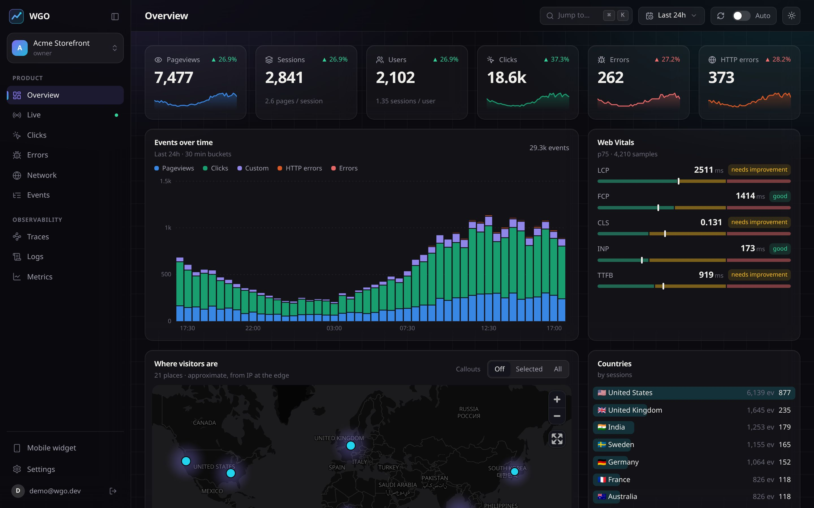
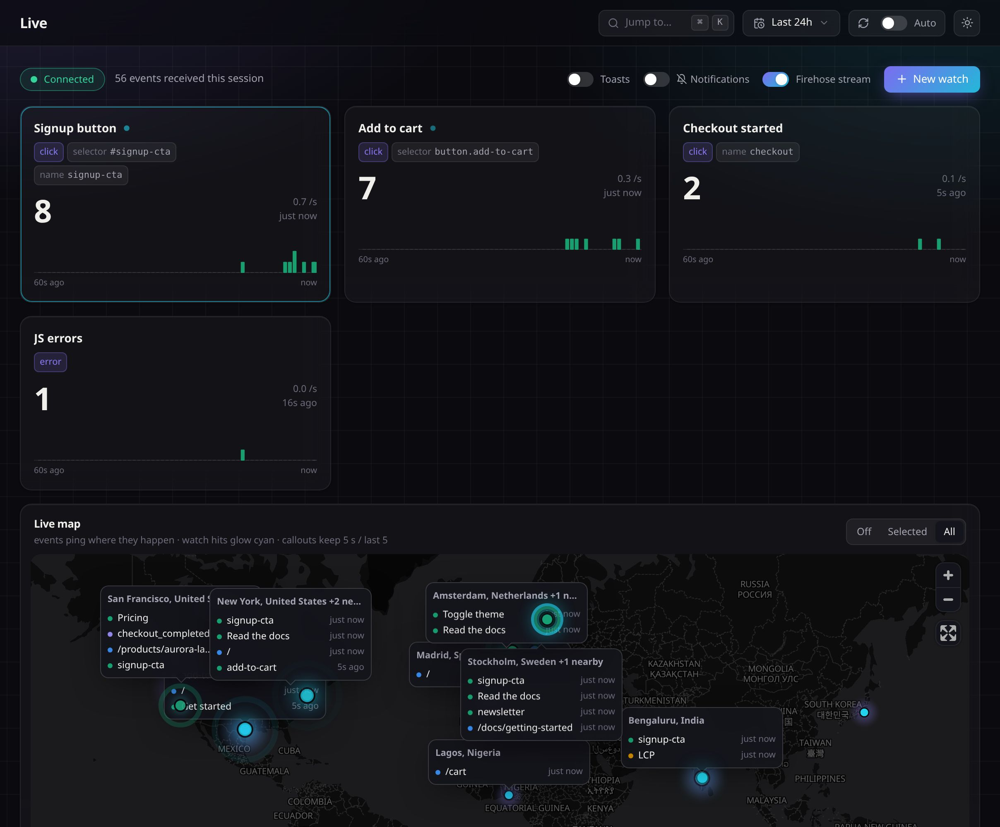
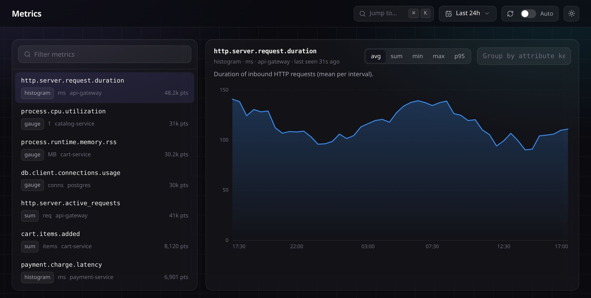
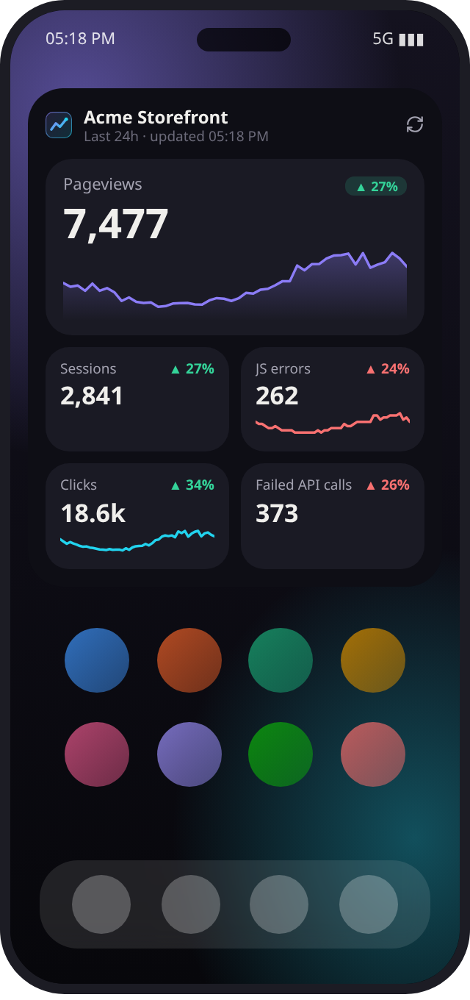
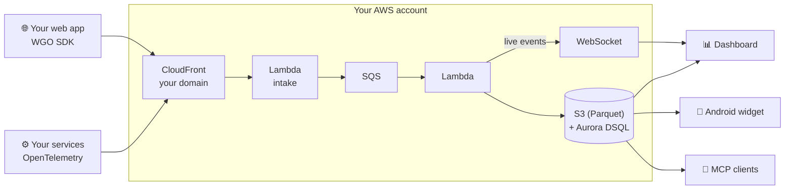

<div align="center">

# WGO

### See what's going on in your web app and the services behind it

WGO monitors your real users in the browser (clicks, pageviews, errors and Web Vitals) and collects traces, logs
and metrics from your backends over OpenTelemetry. It all lands in one dashboard that updates as it happens.

[Web analytics](#live-web-analytics) · [OpenTelemetry](#opentelemetry-metrics-traces-and-logs) · [Alerts](#know-when-something-breaks-and-why) · [GitHub Agent](#github-agent-let-ai-fix-your-errors-opt-in) · [Costs](#see-what-it-costs) · [Android](#a-home-screen-widget-for-android) · [Wall screens](#your-dashboard-on-a-wall-screen) · [MCP](#ask-your-ai-assistant-with-mcp) · [Deploy it yourself](README.md#deploy-it-yourself)

</div>

<br>



---

## Live web analytics

Add one script tag and WGO records every click, pageview, JavaScript error, failed API call and Web Vital
from your real users, without any extra code. Events show up within seconds.

- 👀 Watch a button, page or error and see each hit arrive, with an optional toast or browser notification.
- 🏷️ Give a captured click a readable name, like "Pricing: start trial" instead of `div.w-full > button`. Everyone
  in the project sees the name on the Clicks, Events and Live pages, and so does your AI assistant.
- 🎯 Make any event a conversion goal: a signup click, a visit to /thank-you or a custom event. WGO shows the
  share of sessions that convert, how that changed since the previous period, and the trend.
- 🪜 Open a goal to see how people reach it. Add the steps you expect (Pricing → Signup form → goal) to see
  how many sessions get through each one in order and where the rest leave. WGO also ranks what converts clearly
  better or worse than average: entry pages, pages viewed, traffic sources, devices, browsers and countries. It
  shows the errors that cost conversions, compared with other visitors to the same page, and the most common
  journeys with their conversion rate.
- 🗺️ A live map shows where visitors are, to the nearest city. Locations come from CloudFront, and IP addresses
  are never stored.
- 🎬 Watch what a visitor did: their pointer, clicks, scrolling and page changes, replayed over snapshots of the
  page. It records no video, so a session costs kilobytes. Record a share of sessions, or only the ones that hit an
  error or reach a page you choose, with hourly and daily limits. Typed text is never recorded.
- 💬 Ask visitors questions on your site: multiple choice, text, yes/no, ratings and NPS, built in the dashboard
  with a live preview. Show a survey as a floating card or inside your own page, on the pages, after the delay, scroll
  depth or event you choose. The script you already installed shows it, so there's nothing to deploy. See the answers
  per question, the response rate and every response with its visitor and session, and export them as CSV.
- 😤 See where visitors get stuck: rage clicks, dead clicks (the page did nothing) and clicks followed by an error,
  per element, each with the recordings behind it.
- 🔥 A click heatmap for any page, on desktop or mobile, drawn over a snapshot of the page when recordings are on.
- 🔀 User flows: the paths visitors take page by page, where they leave, and where they hit errors on the way.
  Start from any page to see where people go next.
- 🔁 Retention cohorts: who comes back after their first visit or first conversion, by day, week or month, up to
  400 days back.
- 🧩 Readable stack traces from minified code: upload your source maps from CI with one command. Suppress noise,
  like a browser extension's errors, with wildcard rules.
- 🪶 The browser SDK is about 11 KB gzipped. It batches and compresses events, and holds on to them while the
  visitor is offline.

```html
<script src="https://wgo.example.com/sdk/v1/wgo.js" data-write-key="wk_…" data-endpoint="https://wgo.example.com" async></script>
```



---

## OpenTelemetry metrics, traces and logs

Point any OpenTelemetry SDK or Collector at WGO with three environment variables. Your backend telemetry sits
next to your web analytics, in the same project.

- 📈 Gauges, sums, histograms, exponential histograms and summaries. Chart the average, sum, min, max or p95,
  and split a series by any attribute.
- 🧵 Each trace opens as a span waterfall. Logs can be filtered by severity, service and text, and link to
  their trace.
- 📦 OTLP over HTTP, as protobuf or JSON, gzipped or not.

```sh
OTEL_EXPORTER_OTLP_ENDPOINT=https://wgo.example.com
OTEL_EXPORTER_OTLP_HEADERS=x-wgo-key=wk_…
OTEL_EXPORTER_OTLP_PROTOCOL=http/protobuf
```

The dashboard has a setup guide for Node.js and Python, on servers and AWS Lambda.



---

## Know when something breaks, and why

- 🔗 A failed request in the browser opens the backend trace it started, and the trace links back to the visitor's
  session and recording.
- 🏷️ Tell WGO which version is running and every release is compared with the one before it: errors, failed
  requests, Web Vitals and conversion. Deploys show as markers on the charts.
- 🤔 When a number on the Overview moves, **Why?** says which page, browser, country or release accounts for it,
  when it started and which release went out just before.
- 🚨 Alert on each matching event, on a threshold ("no pageviews in 30 minutes", "p95 above 1 s") or on anything
  unusual for the time of day, in Slack or by webhook. Save destinations once, for a project or for yourself
  across all your projects, and reuse them in any trigger.
- 💓 Uptime checks fetch your URLs every 1, 5 or 15 minutes. A check goes down after two failures in a row.

---

## GitHub Agent: let AI fix your errors (opt-in)

Click **Fix with agent** on a JavaScript error, a failed span or an error log, and the GitHub Agent (Claude, on Amazon
Bedrock in your AWS account or through the Claude API) reads your GitHub repository, finds the cause and opens a
draft pull request for you to review.

- 🔎 It starts from what WGO already knows: the source-mapped stack and what the visitor did right before the error,
  or for a backend error, the exception, the whole trace and its logs.
- 🤖 Let it start by itself for error groups that pass a number of events and sessions in an hour, up to a daily
  limit.
- 🔐 It can read code and open pull requests, nothing else. It never runs your code and can't touch CI, build files,
  dependencies or secrets, and every pull request is a draft for a person to merge.
- 💵 Each run shows the tokens it used and what they cost.

---

## See what it costs

WGO runs in your AWS account, so the bill is yours, and so is the view of it.

- 💰 The Costs page shows what the install costs this month, per day and per AWS service, and about how much that
  is per million events. Only admins see it.
- 🧮 Budgets set a monthly limit for the whole install or one project. They alert as spend passes the percentages you
  choose, or when the month's forecast passes the limit, in Slack or by webhook.
- ✋ A budget can also stop collecting data when it's reached, until the month ends or you raise the limit.

Cost figures are estimates. Set up [AWS Budgets](https://console.aws.amazon.com/billing/home#/budgets) for your
whole account too.

---

## A home-screen widget for Android

<table>
<tr>
<td width="60%" valign="top">

Keep the numbers you care about on your phone. Pick a project, a time range and up to eight stats: visitors
right now, errors, failed API calls, Web Vitals, backend latency, your tracked clicks or any OpenTelemetry
metric.

- 📐 Resize it from a single number at 2×1 up to a chart with a grid of tiles at 4×3.
- 📱 Connect the phone by scanning a QR code in the dashboard. It gets a read-only key that you can revoke at
  any time.
- 🔄 It refreshes in the background every 15 to 180 minutes, or immediately when you tap refresh. You can
  download the app after signing in.

</td>
<td width="40%" align="center">

</td>
</tr>
</table>

---

## Your dashboard on a wall screen

Put a project on a TV in the office. Create a kiosk in the dashboard and run the one command it shows on a
Raspberry Pi. The Pi starts straight into the dashboard, full screen, and you control it from WGO without
touching the Pi again.

- 🖥️ Every page fits the screen, with no scrolling. Taller pages zoom out, and the widgets move side by side to
  use the width. The Overview fits on a 1080p TV at about 75%. Long lists such as Events and Logs show their
  newest rows at full size.
- 🔁 Show one page or rotate through several, each with its own time range, filters and caption. Or set up any
  page as you like and click **Show on kiosk**.
- 🔒 The screen needs no sign-in. Its link gives read-only access to one project, and you can replace the link at
  any time.
- 🔌 It runs unattended. It waits for the network at boot, keeps showing the last data while offline and
  restarts the browser if it exits.

See [Kiosk screens](README.md#kiosk-screens-your-dashboard-on-a-tv) for the setup.

---

## Ask your AI assistant with MCP

Connect Claude, VS Code or any other MCP client to WGO and ask about traffic, errors, traces and metrics in
plain language. The assistant looks up the numbers itself, so you don't have to paste screenshots into the
chat.

- 🔑 You sign in with your WGO account in the browser. There is no API key to copy.
- 🔒 Access is limited to the projects you are a member of. It's read-only, except that the assistant can give
  click targets readable names and create a project.
- 🚀 Ask it to "add WGO to this site": it creates the project and pastes the script tag, with the new write key
  filled in, into your code.
- 🧰 Twenty-eight tools cover project setup, the overview, top pages and clicks, click names, frustration,
  conversion goals and funnels, user flows, retention, errors, failed requests, releases, explanations of a change, Web Vitals,
  visitor locations, recordings, uptime, traces, logs and metrics. Ask for "sessions that hovered the buy button but never clicked it".

```sh
claude mcp add --transport http wgo https://wgo.example.com/mcp
```

<table>
<tr><td>

<sub>Example conversation in an MCP client</sub>

<p align="right"><b>Checkout complaints started this afternoon. What's going on?</b></p>

<sub>🔧 <code>wgo.list_errors</code> range: "24h"</sub><br>
<sub>🔧 <code>wgo.list_failed_requests</code> range: "24h"</sub><br>
<sub>🔧 <code>wgo.list_traces</code> service: "payment-service", errors: true</sub>

🤖 Failed calls to `POST /api/checkout` went from a handful an hour to 41 since 14:00, almost all 502s. The
matching traces in payment-service spend 8–10 s waiting on the card processor before timing out.

The browser side follows from that: most new JavaScript errors are a TypeError on /checkout, thrown when the
response body is empty.

</td></tr>
</table>

---

## Your data stays in your AWS account

WGO is open source and runs on API Gateway, SQS, Lambda, S3, Aurora DSQL, DynamoDB and CloudFront in the account it's
deployed to. It scales to zero when nobody is using it. Incoming data is queued the moment it arrives, so your pages and
services never wait for it to be processed.



<div align="center">

**[Deploy it yourself →](README.md#deploy-it-yourself)**

<sub>Open source under the [MIT license](LICENSE)</sub>

</div>
