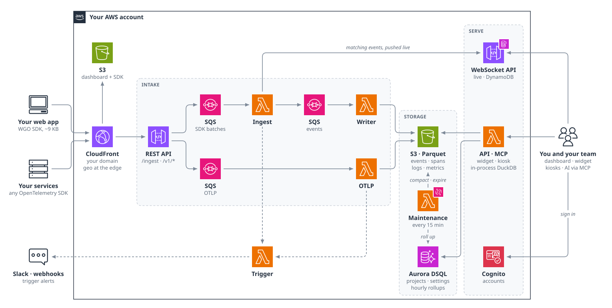

# WGO: What's going on?

**See what's going on in your web app and the services behind it.** WGO is open-source, self-hosted product
analytics and observability that you deploy into your own AWS account with one command.

Add one script tag to a web app and WGO records every click, pageview, JavaScript error, failed API call and
Web Vital, with no extra code. Point your backends' OpenTelemetry exporters at it and their traces, logs and
metrics land in the same project. Everything shows up in one dashboard that updates as it happens.


- **Your data stays in your AWS account.** Nothing is sent to a third party, IP addresses are never stored,
  and no cookies are set; cookieless mode doesn't use `localStorage` either ([details](#cookies-and-privacy)).
- **Serverless, scales to zero.** Lambda, API Gateway, S3 (Parquet, queried with DuckDB), Aurora DSQL, DynamoDB,
  Cognito and CloudFront. There
  are no servers or databases to patch, and an idle install costs close to nothing.
- **One deploy script.** It creates the stack, builds the dashboard and SDK, uploads them and prints your URLs.
- **MIT licensed.**

## Features

### Live web analytics

Add one script tag and WGO records clicks, pageviews, JavaScript errors, failed API calls and Web Vitals.
Events show up within seconds.

- **Live watches:** watch a button, page or error and see each hit arrive over a WebSocket, with an optional
  toast or browser notification.
- **Visitor map:** a zoomable map shows where visitors are, to the nearest city. Locations come from CloudFront
  at the edge, and IP addresses are never stored.
- **Small SDK:** about 10 KB gzipped. It batches and compresses events, and holds on to them while the visitor
  is offline.


### OpenTelemetry metrics, traces and logs

Point any OpenTelemetry SDK or Collector at WGO with three environment variables. Your backend telemetry sits
next to your web analytics, in the same project.

- **Metrics:** gauges, sums, histograms, exponential histograms and summaries. Chart the average, sum, min, max
  or p95, and split a series by any attribute.
- **Traces:** each trace opens as a span waterfall.
- **Logs:** filter by severity, service and text, and jump to the log's trace.
- **Protocol:** OTLP over HTTP, as protobuf or JSON, gzipped or not.


### Ask your AI assistant with MCP

Connect Claude, VS Code, Cursor or any other MCP client and ask about traffic, errors, traces and metrics in
plain language. You sign in with your WGO account in the browser, so there is no API key to copy. Access is
limited to the projects you are a member of and is read-only, except that the assistant can name click targets.

### A home-screen widget for Android


Keep the numbers you care about on your phone. Pick a project, a time range and up to eight stats: visitors
right now, errors, failed API calls, Web Vitals, backend latency, your tracked clicks or any OpenTelemetry
metric.

- Resize it from a single number at 2×1 up to a chart with a grid of tiles at 4×3.
- Connect a phone by scanning a QR code in the dashboard. It gets a read-only key that you can revoke at any time.
- It refreshes in the background every 15 to 180 minutes, or immediately when you tap refresh.

<br clear="right">

### Kiosk screens: your dashboard on a TV

Turn a Raspberry Pi and a TV into a wall display for a project. Create a kiosk on the **Kiosks** page and run the
one command it shows on the Pi:

```bash
curl -fsSL https://wgo.example.com/downloads/wgo-kiosk.sh | sudo bash -s -- 'https://wgo.example.com/#/kiosk/ks_…'
```

The Pi boots straight into the dashboard, full screen, and you control it from WGO without touching the Pi again.

- **Choose what it shows.** Pick one or more pages (Overview, Live, Errors, Traces, Logs, Metrics…), each with its
  own time range, filters and caption. With several pages, the screen switches between them on a timer. Or open any
  page, set it up as you want it, and click **Show on kiosk** in the header. The Live page brings your watches along.
- **Changes show up within 15 seconds.** Theme, zoom (200% suits a 4K TV) and refresh rate are set remotely too, and
  **Reload** reloads the page on the screen.
- **No sign-in on the screen.** The kiosk URL holds a long random token, which gives read access to that project's
  analytics and nothing else. Members can see the link, and can replace it if it leaks or delete the kiosk.
- **Unattended.** It waits for the network at boot, keeps showing the last data while offline, keeps the display awake,
  hides the pointer and fits every page to the screen. The browser restarts if it exits, and once a night.
  The status (on screen, last seen, resolution) shows on the Kiosks page.

#### Every page fits the screen

A kiosk page never scrolls. When a page is taller than the screen, the kiosk zooms it out until it fits, down to
30%. Zooming out also gives the page more room across, so the widgets move side by side, just as they do on a
wider monitor. The page doesn't only get smaller. On a 1080p TV the Overview fits at about 75%, with the widgets
three across. On a small 1024×600 panel it needs about 40%.

- **The zoom setting is the largest size.** A page that fits at the kiosk's zoom (100% by default) shows at that
  size. Only taller pages are zoomed out.
- **Long lists are cut off instead.** Events, Logs and Traces are too long to fit at any size. They show at full
  size with the newest rows at the top, and the rest is cut off at the bottom.
- **It follows the content.** When data loads or a list grows, the page zooms out further. Every 30 seconds it
  checks whether it can zoom back in. On a small screen, a page with fewer widgets (Live, Errors, Clicks) shows
  larger than the Overview.

The script works on Raspberry Pi OS Bookworm or newer, Lite or Desktop, on a Pi 3, 4, 5 or Zero 2 W. It runs
Chromium in [cage](https://github.com/cage-kiosk/cage), a compositor for a single full-screen app, as an
unprivileged `wgo-kiosk` user from boot. On Raspberry Pi OS Desktop the desktop no longer starts at boot. On the
Pi, `sudo wgo-kiosk --status` shows whether it's running, `sudo wgo-kiosk '<new link>'` changes the link, and
`sudo wgo-kiosk --uninstall` removes it and restores the desktop. Any other screen works too: open the kiosk link
full screen in a browser.

### Filters and triggers

Every analytics page, plus Logs and Traces, has a filter bar. Filter on any field, event property
(`props.plan`), or OpenTelemetry attribute (`attributes.http.route`, `resource.service.version`). Operators:
equals, does not equal, contains, does not contain, begins with, ends with, `>` `≥` `<` `≤`, is set and is
not set. Filters live in the URL, so a filtered view is a shareable link. Expand any event or log line to see
all its attributes, and click one to filter by it.

**Triggers** notify you when new events match a filter. Create one from the current filters (**Create
trigger** in the filter bar), from any event (**Create trigger from this event**), or on the Triggers page.
- **Slack:** click **Add to Slack**, pick the workspace and channel on Slack, done. Slack ties every
  "Add to Slack" button to a Slack app, so a self-hosted WGO needs its own, created once. The Triggers
  page walks a project owner through it in about a minute: **Create the WGO Slack app** opens Slack
  pre-filled (you only pick the workspace), then paste the Client ID and Secret, and WGO checks them with
  Slack. To set it up once for every project instead, put `SLACK_CLIENT_ID` and `SLACK_CLIENT_SECRET` in
  `deploy.env`.
- **Webhooks:** an HTTPS POST of JSON with `trigger`, `project`, `matches`, `events` and `url`. It's signed
  with `X-WGO-Signature: sha256=<HMAC-SHA256 of the body>` using the trigger's signing secret. Private
  and internal addresses are refused.
- **Cooldown:** at most one notification per period you choose. Matches in between are counted and
  reported with the next one. **Test** sends a sample notification immediately.

### Teams and access control

Accounts use Cognito with email sign-up. Projects have owners and members, and you can invite people by email.
You can limit sign-ups to your company's email domains, or turn off self sign-up completely.

## Deploy it yourself

### Prerequisites

| | |
|---|---|
| **AWS account** | With permission to create IAM roles, Lambda, API Gateway, Aurora DSQL, DynamoDB, Cognito, S3 and CloudFront (and Route 53 / ACM if you use a custom domain). An administrator role is the simplest. |
| **A supported region** | Any region where [Aurora DSQL is available](https://docs.aws.amazon.com/aurora-dsql/latest/userguide/what-is-aurora-dsql.html#region-availability). |
| **AWS CLI v2** | [Installed](https://docs.aws.amazon.com/cli/latest/userguide/getting-started-install.html) and configured with credentials for the account (`aws sts get-caller-identity` should work). |
| **AWS SAM CLI** | [Installed](https://docs.aws.amazon.com/serverless-application-model/latest/developerguide/install-sam-cli.html). Docker is not needed: functions are bundled with esbuild. |
| **Node.js 22+** | With npm. |
| **bash** | Linux, macOS or WSL. |

Optional:

| | |
|---|---|
| **A domain** | To serve WGO on e.g. `wgo.example.com`. Fully automatic if the domain's hosted zone is in Route 53 in the same account. |
| **JDK 17+ and the Android SDK (platform 35)** | Only to build the Android widget app. Without them, the deploy skips that step. See [android/README.md](android/README.md). |

### Quick start

```bash
git clone <this repo> wgo && cd wgo
npm run setup
```

`npm run setup` is a wizard for your first deploy. You don't need `npm install` first. It asks for:

- your AWS profile and region (it checks that Aurora DSQL is available there)
- your domain: it finds the Route 53 zone, or a matching certificate if your DNS is elsewhere
- which email domains can sign in, with a live check of test addresses
- which features to turn on

It saves your answers to `deploy.env` and can start the deploy for you. Run it again whenever you want to change a
setting. Your current settings are the defaults, and keys it doesn't ask about are kept.

To skip the wizard, copy `deploy.env.example` to `deploy.env`, edit it, and run `./scripts/deploy.sh` (or
`npm run deploy`).

The deploy:
1. Creates a DNS-validated certificate in us-east-1, if you set a custom domain in Route 53.
2. Installs, type-checks and unit-tests the backend, then builds and deploys it with SAM. A migration runs the
   database schema as part of the deploy.
3. Builds the browser SDK, the Android app (if the toolchain is installed) and the dashboard.
4. Uploads them to the stack's S3 bucket, invalidates CloudFront, and prints your URLs:

```
✔ WGO deployed
  Dashboard  https://wgo.example.com
  Sign up    https://wgo.example.com/#/signup      (create your account here; the homepage doesn't link to it)
  API        https://….execute-api.eu-west-1.amazonaws.com
  Live       wss://….execute-api.eu-west-1.amazonaws.com/live
  SDK        https://wgo.example.com/sdk/v1/wgo.js
  Ingest     https://wgo.example.com      (SDK data-endpoint)
  OTLP       https://wgo.example.com/v1/{traces,logs,metrics}   (header x-wgo-key)
  MCP        https://wgo.example.com/mcp      (claude mcp add --transport http wgo https://wgo.example.com/mcp)
```

The first deploy takes several minutes, mostly for CloudFront. Without a custom domain, WGO is served on its
`*.cloudfront.net` address.

### First steps

1. Open `https://wgo.example.com/#/signup` and create your account. Cognito emails you a verification code.
   The dashboard's homepage presents the project and doesn't link to the sign-up form, so give this address to
   teammates too.
2. Create a project.
3. Copy the install snippet from the onboarding screen (or later from **Settings → Install**) into your web
   app, and/or set the [OpenTelemetry variables](#backends-opentelemetry) on your services.
4. Watch the data arrive. To try it without your own app, serve [examples/demo.html](examples/demo.html)
   locally and open it with
   `?key=wk_…&endpoint=https://wgo.example.com&sdk=https://wgo.example.com/sdk/v1/wgo.js&auto=1`
   (`auto=1` makes it click through the shop by itself).

### Configuration

`npm run setup` writes most of these for you. You can also set them as environment variables or in `deploy.env`
(gitignored). They map to stack parameters, so you can
change them later by re-running the deploy.

| Variable | Default | |
|---|---|---|
| `STACK_NAME` | `wgo` | CloudFormation stack name |
| `AWS_REGION` | CLI default | Region of the stack |
| `AWS_PROFILE` | CLI default | AWS CLI profile to deploy with |
| `CUSTOM_DOMAIN` | none | Serve dashboard, SDK and ingest on your own domain, e.g. `wgo.example.com` |
| `HOSTED_ZONE_ID` | auto-detected | Route 53 zone of `CUSTOM_DOMAIN`; found automatically if it's in the same account |
| `CERTIFICATE_ARN` | created for you | ACM certificate in **us-east-1**; only needed when your DNS is not in Route 53 |
| `ALLOWED_EMAIL_DOMAINS` | anyone | Comma-separated, e.g. `example.com,*.example.org`; only these emails can sign up and use the dashboard |
| `ALLOW_SELF_SIGNUP` | `true` | `false` = only users you create in Cognito can sign in |
| `DELETION_PROTECTION` | `false` | DSQL cluster deletion protection; turn on for production |
| `MCP_ENABLED` | `true` | The [MCP server](#ai-assistants-mcp) at `/mcp`, with Cognito MCP auth (open client registration) |
| `MAX_RETENTION_DAYS` | `400` | Longest raw-data retention a project owner can choose (the default is 90 days); see [Cost awareness](#cost-awareness) |
| `WRITE_BUFFER_SECONDS` | `30` | How long incoming events, logs, spans and metrics are collected before they are written as one Parquet file (1–300). Shorter means fresher charts, longer means fewer files. The Live page and triggers don't wait for it |
| `CLUSTER_METRICS_PROJECT_ID` | none | Project that receives hourly Aurora DSQL storage and DPU numbers, as metrics and as a `wgo.cluster` event you can create triggers on |
| `BUILD_ANDROID` | `false` | `true` = rebuild the Android app (needs JDK 17 and the Android SDK) instead of deploying the prebuilt APK from the repo |
| `SLACK_CLIENT_ID` / `SLACK_CLIENT_SECRET` | none | One Slack app for "Add to Slack" in every project's [triggers](#filters-and-triggers); otherwise each project sets it up from its Triggers page |
| `PARAMS` | none | Extra raw `sam deploy --parameter-overrides` |

**Custom domain.** With `CUSTOM_DOMAIN=wgo.example.com`:
- **DNS in Route 53, same account:** the script creates and DNS-validates a certificate in us-east-1 (a
  separate `<stack>-certificate` stack) and the main stack creates the `A`/`AAAA` records. Nothing else to do.
  The first run waits a few minutes for validation.
- **DNS elsewhere:** request an ACM certificate for the domain in **us-east-1** yourself, set
  `CERTIFICATE_ARN`, deploy, then point a `CNAME` at the `CloudFrontDomain` stack output.

**Restricting who can sign in.** With `ALLOWED_EMAIL_DOMAINS=example.com`, a Cognito pre-sign-up trigger
rejects other domains, and the API, WebSocket and invites enforce it too. That also covers accounts created
before the allowlist was set. `*.example.com` matches subdomains. With `ALLOW_SELF_SIGNUP=false`, create users
yourself:

```bash
aws cognito-idp admin-create-user --user-pool-id <UserPoolId output> --username alice@example.com
```

Cognito emails them a temporary password. Users created this way still need an allowed domain to use the
dashboard.

**Email delivery.** Cognito sends verification and invitation emails with its built-in sender, which has a low
daily quota. For a larger team, configure the user pool to send through Amazon SES.

### Updating

Pull the latest code and run `./scripts/deploy.sh` again. Schema migrations run automatically.

To ship only dashboard or SDK changes to an existing stack (no SAM, about 30 s):

```bash
./scripts/deploy.sh --frontend-only
```

### Cost awareness

Everything is billed per request and per GB, so an idle install costs close to nothing and the bill follows
your traffic. Raw telemetry is stored as compressed Parquet files in S3 and queried by DuckDB inside the API
Lambda; Aurora DSQL only holds projects, settings, error stacks and the hourly aggregates. You pay for S3
(storage and requests), Lambda, SQS, API Gateway, CloudFront, Cognito and a little DSQL. Cognito runs on the
Essentials tier, which MCP sign-in requires; check [Cognito pricing](https://aws.amazon.com/cognito/pricing/)
for its monthly active user allowance.

As traffic grows, cost comes from four places:

1. **Stored data.** Raw events, logs, spans and metric points are kept for each project's **retention**
   (Settings → Data retention, 90 days by default), then deleted a whole day at a time. They are stored as
   ZSTD-compressed Parquet, usually a tenth of the raw size or less, at S3 Standard prices.
   `MAX_RETENTION_DAYS` caps what project owners can choose, which matters when anyone can sign up and create
   projects on your stack.
2. **Ingest.** Events and OTLP requests are queued in SQS and written as one Parquet file per project and day
   every `WRITE_BUFFER_SECONDS`, so the cost is a few Lambda invocations and S3 PUTs per minute rather than
   one write per row. The maintenance job merges each day's small files. OpenTelemetry logs and spans are
   usually the largest share of the data: filter or sample them in your collector before they reach WGO. For
   high-traffic sites, the browser SDK's `sampleRate` keeps a fraction of sessions. Error stack traces are
   stored once per error group, not on every error event.
3. **Dashboard queries.** A query reads the Parquet files of the days in the selected range (only the columns
   it needs), so its cost and time grow with traffic times the range length.
   - The Overview's KPIs, events chart, top pages and breakdowns read **hourly aggregates** for ranges of 3
     days or more (and for anything older than the retention), as long as no filters are set. Their cost
     depends on the number of hours, not on traffic. Sessions and users there are estimates (about ±2%).
   - Filters, and the Clicks, Errors, Network, Events, map, Web Vitals, Logs, Traces and Metrics views, read
     raw rows.
   - Auto-refresh re-runs the visible queries: every 15 s for the last 15 min or hour, every minute for 24 h,
     every 5 min for 7 days, every 15 min for 30 days. The comparison numbers (the ▲/▼ deltas) refresh on a
     slower clock. A tab left open on a long, filtered range with auto-refresh on is the most expensive
     way to use WGO.
4. **Background work.** A maintenance Lambda runs every 15 minutes. It merges small Parquet files, builds the
   hourly aggregates (reading each hour of events a few times), deletes expired days once a day, and stops
   after 12 minutes, continuing on its next run. On first deploy it builds aggregates for the data you already
   have, up to 92 days back. Upgrading from a version that kept raw data in DSQL, it first moves those rows
   into Parquet, a chunk at a time, and then deletes them from DSQL.

**Watch the bill.** Set `CLUSTER_METRICS_PROJECT_ID` to a project's id (from its Settings page). Every hour
that project receives the cluster's storage size and DPU usage as the metrics `wgo.dsql.storage_bytes` and
`wgo.dsql.dpu`, to chart on the Metrics page or the Android widget. It also receives a custom event
`wgo.cluster` with `storageGb`, `dpuLastHour` and `dpuLast24h` in its props. A trigger such as
`name = wgo.cluster` and `props.storageGb > 5` posts to Slack or a webhook when the cluster grows past
5 GB. For a hard monthly limit, also set up an [AWS Budget](https://docs.aws.amazon.com/cost-management/latest/userguide/budgets-managing-costs.html).

### Removing WGO

```bash
aws s3 rm "s3://$(aws cloudformation describe-stacks --stack-name wgo \
  --query "Stacks[0].Outputs[?OutputKey=='WebBucketName'].OutputValue" --output text)" --recursive
sam delete --stack-name wgo
sam delete --stack-name wgo-certificate --region us-east-1   # only if a certificate was created
```

If `DELETION_PROTECTION` is on, redeploy with it set to `false` first. **Deleting the stack deletes all
collected data.**

## Instrumenting your apps

### Web apps

Paste the snippet from the dashboard. Every click, pageview, JS error, failed request and Web Vital is
captured automatically:

```html
<script src="https://wgo.example.com/sdk/v1/wgo.js" data-write-key="wk_…" data-endpoint="https://wgo.example.com" async></script>
```

`data-track="signup-cta"` gives a click a friendly name for the dashboard and live watches.
`data-wgo-ignore` and `data-wgo-mask` exclude elements or their text. `WGO.track('event', props)` sends
custom events, and `WGO.status()` in the browser console shows what the SDK is doing. See
[sdk/README.md](sdk/README.md) for options, npm usage, frameworks and tag managers.

### Backends (OpenTelemetry)

Point any OTLP/HTTP exporter at your WGO with the project's write key:

```bash
OTEL_EXPORTER_OTLP_ENDPOINT=https://wgo.example.com
OTEL_EXPORTER_OTLP_HEADERS=x-wgo-key=wk_…
OTEL_EXPORTER_OTLP_PROTOCOL=http/protobuf   # or http/json
```

Traces, logs and metrics (gauge, sum, histogram, exponential histogram, summary) are accepted as protobuf or
JSON, optionally gzip-compressed. gRPC is not supported, so use the HTTP exporters. CloudFront doesn't
forward `Authorization`, so use the `x-wgo-key` header.

Requests are queued and answered right away, so exporters never wait for a Lambda cold start or for the
database; data shows up a second or two later. Because the write key is checked when a request is stored, a
wrong key doesn't produce an error response: the data is dropped and the OTLP function logs why. A request
can be up to about 750 KB as sent (gzip counts), the size of an SQS message after base64.
The dashboard has a setup guide for Node.js and Python, on servers and AWS Lambda.

## Cookies and privacy

**WGO sets no cookies**, neither on your visitors nor in the dashboard. The CloudFront distribution doesn't
forward cookies to the backend either, so cookies your own site sets on the same domain never reach WGO.

**What the SDK stores in the browser.** The browser SDK uses your site's `localStorage`:

| Key | Contents | Kept until |
|---|---|---|
| `wgo:aid` | A random anonymous visitor id (UUID), so returning visitors are counted once | The visitor clears site data |
| `wgo:sid` | Session id, time of last activity, and whether this session is sampled | Replaced after 30 minutes of inactivity (`sessionTimeout`) |
| `wgo:uid` | The user id you pass to `WGO.identify()`, or the one `autoIdentify` read from your app's JWT | `WGO.reset()` or the visitor clears site data. Only set if you identify users |
| `wgo:um` | `1` when the user id came from `identify()`, so a JWT doesn't replace it | Same as `wgo:uid` |
| `wgo:q:<writeKey>` | Events that haven't been sent yet, e.g. while offline | They are delivered. Turn off with `persist: false` |

**Storing nothing: cookieless mode.** Add `data-cookieless` to the script tag (or `cookieless: true` with npm)
and the SDK keeps everything above in memory, so it writes nothing to `localStorage`, `sessionStorage` or
cookies. The trade-offs:
- Every page load is a new visitor and a new session, so visitor and session counts go up and multi-page
  journeys (funnels, paths) break at each full page load. Single-page apps keep one session while the tab
  stays open.
- Events that couldn't be sent before the page closed (e.g. offline) are lost.
- Logged-in users must be identified again on every page load: call `WGO.identify()` each time, or use
  `data-auto-identify`.

**What is collected.** With each event: the anonymous id, the session id, the page URL and referrer (query
strings stripped unless `captureQueryParams` is on), browser, OS and device type (parsed from the user agent,
which itself is not stored), language, screen size and time zone, and a city-level location from CloudFront.
IP addresses are never stored. For clicks, the SDK records the element's selector and a short label, such as
its text, `aria-label` or the label of a form field. It never records what someone typed into a field, and it
records no label for fields that look like passwords, secrets, tokens, CVV or social security numbers. Mark
anything else private with `data-wgo-mask` or `data-wgo-ignore`.

**User ids.** Events only carry a user id if you identify users: with `WGO.identify()`, or with
`data-auto-identify`, which reads the email or username from a JWT your app keeps in the browser or sends in an
`Authorization` header (see the [SDK README](sdk/README.md#identifying-users)). Both are off until you use
them. An email address is personal data, so cover it in your privacy notice. Once a browser is identified, its
earlier anonymous events are attributed to that user too. Call `WGO.reset()` on logout.

**Consent.** Under EU and UK rules (the ePrivacy Directive and PECR), storing an identifier in `localStorage`
is treated the same as setting a cookie. "No cookies" therefore doesn't mean you can skip consent. Whether
you need consent depends on where you operate and how you use the data, so check with whoever handles
privacy for your site. If you need consent first:
- Load the SDK only after the visitor agrees. With the script tag, inject the tag from your consent
  callback. With npm, call `init()` from it.
- To honour a withdrawal, stop the SDK and remove what it stored:
  ```js
  WGO.shutdown()
  Object.keys(localStorage).filter((k) => k.startsWith('wgo:')).forEach((k) => localStorage.removeItem(k))
  ```
- `data-respect-do-not-track` (or `respectDoNotTrack: true`) turns the SDK off for browsers that send Do Not
  Track.
- [Cookieless mode](#cookies-and-privacy) stores nothing on the device. That removes the storage these rules
  are about, but whether it is enough for your site is still a question for whoever handles privacy.
  `data-auto-identify` reads your app's tokens from storage and cookies, so leave it off if the point is not
  to touch the device at all.

**The dashboard** keeps your sign-in tokens in `sessionStorage`, or in `localStorage` if you tick "Keep me
signed in", plus a few display preferences in `localStorage`. MCP sign-in goes through Cognito's managed login
page, which sets its own session cookies on the Cognito domain.

## AI assistants (MCP)

WGO is a remote [MCP](https://modelcontextprotocol.io) server:

```bash
claude mcp add --transport http wgo https://wgo.example.com/mcp
```

There is no key to copy. The client registers itself, opens a browser, and you sign in with your WGO account.
It then sees exactly the projects you're a member of. The tools are:
- **Product analytics:** `list_projects`, `get_overview`, `top_clicks`, `top_pages`, `goal_conversions`, `goal_funnel`, `list_errors`, `list_failed_requests`, `breakdown`, `web_vitals`, `visitor_locations`, `search_events`
- **Click aliases:** `list_click_aliases`, and `set_click_alias`, which gives an autocaptured selector a readable name. It's the only tool that changes anything, and it only changes labels that any project member can also edit in the dashboard.
- **OpenTelemetry:** `list_services`, `list_traces`, `get_trace`, `search_logs`, `list_metrics`, `get_metric_series`

Use the dashboard's host (the `McpUrl` stack output). The raw API Gateway URL has no OAuth resource of its own.

**How auth works.** Authorization uses Cognito's MCP auth features:
- **Discovery.** `/mcp` answers unauthenticated calls with a `401` pointing at `/.well-known/oauth-protected-resource/mcp` (RFC 9728). That document names the authorization server, and `/.well-known/oauth-authorization-server` describes Cognito's endpoints.
- **Registration.** The client registers through Cognito's open [dynamic client registration](https://docs.aws.amazon.com/cognito/latest/developerguide/cognito-user-pools-dynamic-client-registration.html) (`/oauth2/register`).
- **Sign-in.** The user signs in on Cognito managed login with PKCE.
- **Binding.** The client asks for a token bound to the MCP URL with an RFC 8707 resource indicator. A Cognito resource server whose identifier is the MCP URL gives that token `aud` = the MCP URL and the scope `<MCP URL>/read`. The MCP function rejects tokens for any other audience or without that scope, then looks up the user's email in Cognito. The email allowlist applies here too.

This needs the Cognito Essentials tier (set on the pool) and a managed login domain (created by the stack).

**Open registration.** Anyone who can reach the user pool can register an OAuth client and send your users to
its sign-in link. That is how MCP clients connect without setup, but it's also a phishing surface: a malicious
client that tricks a signed-in user gets read access to that user's projects. Set `MCP_ENABLED=false` if you
don't need MCP. Cognito's guidance is to attach an AWS WAF rate-based rule to the user pool for `/oauth2/register`.
Registered clients are not cleaned up automatically. List them with
`aws cognito-idp list-user-pool-clients` and delete the stale ones.

## How it works

<picture>
  <source media="(prefers-color-scheme: dark)" srcset="dashboard/public/home/architecture-dark.svg">
  
</picture>

The SDK and OTLP intake answer as soon as the data is queued (API Gateway writes SDK batches and OTLP requests
straight to SQS, with no Lambda in the request path, so pages and exporters never wait for a cold start);
Lambdas behind SQS write each batch to S3 as Parquet. Write keys are checked behind the queue: data sent with
a wrong key is accepted, then dropped and logged. Queries run
DuckDB inside the Lambda against only the project's files for the days in range, and long ranges use the
hourly rollups in DSQL. The sections below cover each part.

**Buffering (SDK).** Events queue in memory, mirrored to `localStorage`. A batch goes out when it reaches 50
events or ~48 KB, or when the oldest queued event is 5 s old (a max-latency deadline that new events never
push back). Errors, failed requests and `priorityClicks` pull the deadline in to 1 s. Batches over 1 KB are
gzipped. When the page is hidden, everything is flushed with `sendBeacon`. Failures back off exponentially,
and while offline the SDK waits for `online`. Error storms are coalesced, and rage clicks are collapsed into
one event.

**Raw data (Parquet on S3, DuckDB).** Events, spans, logs and metric points live in the `DataBucket` stack
output as `{table}/project_id={id}/dt={YYYY-MM-DD}/*.parquet`. Writers never append: each batch becomes a new
file, and the maintenance job merges a day's small files into one sorted, ZSTD-compressed file, dropping
duplicate rows (an SDK retry or SQS redelivery) on the way; until then readers drop them. The dashboard API,
widget, kiosk and MCP functions run an in-process DuckDB (a Lambda layer with the `httpfs` extension) and read
only the project's files for the days in range. Spans are sorted by trace, so opening a trace reads one row
group per file. You can point DuckDB, Athena or Spark at the bucket yourself. See
[backend/src/lib/store/](backend/src/lib/store/).

**Configuration (Aurora DSQL).** Serverless, scales to zero, PostgreSQL-compatible, so you can query it directly
with `psql` and IAM auth (the `DsqlEndpoint` stack output). It holds projects, members, goals, triggers,
kiosks, saved views, error stacks and the hourly rollups. DSQL constraints shape the code: one DDL per
transaction, `CREATE INDEX ASYNC`, and 3,000 rows or fewer per transaction. See
[backend/src/lib/schema.ts](backend/src/lib/schema.ts).

**Rollups, compaction and retention.** A scheduled maintenance Lambda
([backend/src/handlers/maintenance.ts](backend/src/handlers/maintenance.ts)) runs every 15 minutes:
- **Compaction**: merges the small files of the last three days into files of up to ~48 MB per project and day.
- **Hourly rollups**: for each complete hour, it stores event counts by type, pageviews per path, sessions per
  browser, OS, device, country, city and referrer (counted in the hour they started), and HyperLogLog sketches
  of the hour's session and user ids. Long ranges merge these instead of scanning raw events. A watermark
  marks the last rolled hour; anything after it is read raw, so results are always complete up to now.
  Rollups are kept 400 days.
- **Retention**: once a day, it deletes each project's files of days older than its retention. It never
  deletes events that haven't been rolled up yet.
- **Cluster metrics**: once an hour, if `CLUSTER_METRICS_PROJECT_ID` is set (see
  [Cost awareness](#cost-awareness)).

**Live watches.** The dashboard opens a WebSocket (Cognito ID token + project id), then subscribes with a
list of watches (`{type:'click', name:'signup-cta'}`, selector/text/path substrings…) or the firehose. The
ingest Lambda takes each batch off its queue (no batching window), queues it for storage and, in parallel, matches
it against the project's subscriptions and pushes hits straight to those connections. Click-to-screen latency is
the SDK flush delay plus the queue hop, typically well under a second.

**Visitor location and map.** `/ingest` and `/v1/*` go through the same CloudFront distribution as the
dashboard. CloudFront looks up each viewer's IP at the edge, at no extra cost, and forwards
`CloudFront-Viewer-{Country,City,Latitude,Longitude,…}` headers. Ingest stores country, region, city and
coordinates rounded to 0.1° (~11 km). **The backend never sees or stores IP addresses.** CloudFront adds a
stack-specific secret header, and geo headers without it are ignored, so locations can't be forged by calling
API Gateway directly. The accuracy is city-level: mobile networks and VPNs show where traffic leaves the
network. The map uses OpenStreetMap vector tiles from [OpenFreeMap](https://openfreemap.org) (free, no API
key) rendered with MapLibre GL. It clusters places and can show callouts with the latest events per dot. To
use another tile source, set `mapStyleUrl`/`mapStyleUrlLight` in `config.json`.

**Accounts.** Cognito user pool with email sign-up. The dashboard calls Cognito's API directly (no Amplify),
and API Gateway validates the ID token. Projects have owners and members. Inviting an email grants access the
next time someone signs in with it.

**Android widget.** Phones pair with a read-only, revocable device token that only works on `/widget/v1/*`.

**Kiosks.** A kiosk screen is the dashboard opened at `#/kiosk/<token>`. It calls `/kiosk/v1/*` with that token
instead of a Cognito session. The token pins one project and only the read-only analytics routes. The screen polls
`/kiosk/v1/state` for what to show, which members edit through `/api/projects/{pid}/kiosks`.
See [android/README.md](android/README.md).

### Repository layout

| Path | What |
|---|---|
| [sdk/](sdk/) | Browser SDK: autocapture, intelligent buffering, offline persistence. [README](sdk/README.md) |
| [backend/](backend/) | AWS SAM app: ingest, OTLP, dashboard API, WebSocket live feed, MCP server, DSQL schema migration |
| [dashboard/](dashboard/) | React dashboard: accounts, projects, install snippets, analytics, live watches, map, traces/logs/metrics |
| [android/](android/) | Android home-screen widget app. [README](android/README.md) |
| [examples/demo.html](examples/demo.html) | Demo shop page that exercises every capture type (`?auto=1` drives itself) |
| [scripts/setup.mjs](scripts/setup.mjs) | `npm run setup`: interactive first-deploy wizard that writes `deploy.env` |
| [scripts/deploy.sh](scripts/deploy.sh) | One-shot deploy of everything |

## Local development

```bash
# Postgres stands in for DSQL locally; raw data goes to Parquet files in backend/.wgo-store (STORE_URL)
docker run -d --rm --name wgo-pg -e POSTGRES_PASSWORD=pw -p 55432:5432 postgres:16-alpine

cd sdk && npm i && npm run build && cd ..
cd backend && npm i
DATABASE_URL=postgres://postgres:pw@localhost:55432/postgres npm run dev
# → prints a write key and http://localhost:8787/examples/demo.html?key=wk_…

npm run seed -- --key wk_…                   # optional: 24h of realistic SDK + OTel traffic

cd dashboard && npm i
npm run dev:local                             # real dashboard against the local backend
npm run dev:mock                              # …or against an in-browser mock (no backend needed)
```

The local server runs the real Lambda handlers. It skips Cognito: it serves a `config.json` with
`devEmail`, and every API call acts as that user. The same goes for the MCP server at `http://localhost:8787/mcp`
(`claude mcp add --transport http wgo-local http://localhost:8787/mcp`), which needs no sign-in locally. It also
skips the WebSocket fan-out, so the Live page only works when deployed, or under `dev:mock`.

Tests:

```bash
cd sdk && npm test                       # buffering, capture, selectors, transport (happy-dom)
cd backend && npm test                   # normalization, matching, allowlist, OTLP protobuf≡JSON with real OTel serializers
cd backend && npm run test:integration   # full API + ingest + OTLP against Postgres + Parquet in a temp dir (needs the container above)
```

## Known limits

- The Lambdas connect to DSQL as `admin`. For least privilege, create a custom DB role and
  `AWS IAM GRANT` it to the function roles.
- Deleting a kiosk, or replacing its link, stops its API access within a minute. A live WebSocket the screen already
  has open keeps streaming until it reconnects (API Gateway closes them after 2 hours at most).
- Only the Overview's KPIs, events chart, top pages and breakdowns have rollups. Filtered views and the other
  pages aggregate raw rows, so they only reach back as far as the project's retention, and their cost
  grows with traffic.
- Charts and lists trail live traffic by up to `WRITE_BUFFER_SECONDS` (30 s by default) plus a few seconds of
  file-list caching. The Live page and triggers run at ingest and aren't delayed.
- Raw data is append-only: there is no way to edit or delete single events (for example one user's) short of
  rewriting that day's files. Deleting whole days, through retention, is cheap.
- Duplicate rows are dropped within files not merged yet and within each merge. A retry that arrives after its
  original was merged (rare: retries come within seconds) is counted twice.
- Opening a trace without a time hint (a pasted trace id) searches the last two days first, then every day still
  stored, which is slower.
- Events that arrive more than about an hour after they happened (offline SDK batches) are missing from the
  rollups; raw-backed views still show them.
- In rollup-backed views, top pages add up hourly distinct sessions, so a session spanning several hours
  counts once per hour.
- Cumulative OTLP sums are stored as reported. Chart them with `max`/`avg` rather than `sum`.
- CloudFormation can't configure Cognito dynamic client registration yet, so a custom resource
  (`McpAuth`, [backend/src/handlers/mcpauth.ts](backend/src/handlers/mcpauth.ts)) turns it on with
  `UpdateUserPool`. It runs again whenever the pool's settings change. If you edit `UserPool` in the
  template, bump `PoolConfigVersion` in `McpAuth`.

## Sponsor WGO

WGO is free, open source and built in my spare time. If it saves you from paying for a hosted analytics or
observability service, or you just like having your data in your own account, please consider sponsoring
its development. Sponsorships pay for the time that goes into new features, fixes and keeping up with AWS.

<a href="https://github.com/sponsors/ljacobsson"></a>

Not in a position to sponsor? Starring the repo, reporting bugs and telling others about WGO help too.
See [SPONSORS.md](SPONSORS.md) for what sponsorship pays for and the people who support WGO.

## License

[MIT](LICENSE)
